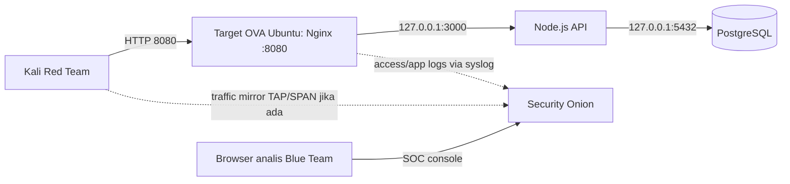

# Panduan skenario dan serah-terima OVA KABITA

## Tujuan dan batas lab

Praktikum purple-team terotorisasi untuk OVA KABITA dan alamat target yang diumumkan fasilitator. Semua akun/data adalah sintetis. Jangan melakukan scan ke jaringan publik, router rumah, atau perangkat lain. Jangan gunakan DoS, malware, persistence, atau pencurian kredensial. Jalankan hanya saat semua anggota berada di jaringan lab yang disepakati.

## Peran dan alur

- **Target node**: Ubuntu Server 24.04.1 di VirtualBox, menjalankan aplikasi di TCP/8080.
- **Security Onion / Blue Team**: teman yang mengelola SOC, mencatat waktu, sumber IP, alert, dan bukti; tidak menyerang.
- **Kali / Red Team**: anggota lain, menguji hanya IP Target Node. Satu orang menjadi pencatat hasil.

Satu subnet Wi-Fi yang sama biasanya cukup agar Kali menjangkau target melalui bridged adapter. Namun, jangan berasumsi Security Onion otomatis melihat unicast antarperangkat. Untuk visibilitas jaringan yang andal gunakan switch managed dengan SPAN/TAP, atau kirim Nginx dan journal aplikasi ke Security Onion melalui syslog. Untuk sesi sederhana, log ingestion memberi bukti request aplikasi; SPAN/TAP memberi bukti paket dan scan. Validasi visibility dengan satu request uji dari Kali dan pastikan event muncul di SOC sebelum mulai.

## Urutan tabletop/live lab (45–60 menit)

1. **Brief & baseline (5–10 menit)** — Blue Team mengumumkan subnet dan satu IP target; Kali mencatat IP sumbernya. Pastikan hanya port 8080 untuk web dan port 22 hanya untuk admin. Sepakati kata berhenti dan jangan mengubah mode sebelum bukti tahap itu disimpan.
2. **Baseline hardened (5 menit)** — pemilik VM menjalankan `sudo kabita-mode hardened`. Dari browser buka `http://IP-TARGET:8080`. Blue Team memastikan event web terlihat di log/SOC.
3. **Recon terbatas (5 menit)** — Kali hanya memeriksa host target dan layanan yang memang dipublikasikan, misalnya `nmap -Pn -sT -p 22,8080 IP-TARGET`. Tidak perlu scan seluruh subnet. Catat command, waktu, source IP, port/state; Blue Team cari flow/alert dan cocokkan timestamp.
4. **Eksploitasi aplikasi demo (10–15 menit)** — pemilik VM berganti ke `sudo kabita-mode vulnerable`; Red Team menguji empat skenario sintetis di `redteam/attack_plan.md`: akun legacy lemah, IDOR detail data peternak lain, ingest sensor tanpa token, dan debug export tanpa autentikasi. Gunakan hanya akun/dataset dummy. Simpan request/response dan event log.
5. **Deteksi & respons (10 menit)** — Blue Team identifikasi alert/log (login legacy, akses lintas owner, ingest tanpa autentikasi, debug export), kaitkan source IP, endpoint, status HTTP, dan waktu; catat tindakan mitigasi.
6. **Remediasi & retest (10 menit)** — pemilik VM kembali ke `sudo kabita-mode hardened`; ulangi request yang sama. Harapan respons: akses ditolak/objek disamarkan sesuai attack plan. Pastikan event penolakan terlihat dan aplikasi normal tetap berfungsi.
7. **Wrap-up (5 menit)** — simpan bukti, checklist, daftar celah/mitigasi dan keterbatasan visibilitas. Matikan mode vulnerable dan matikan VM/isolasi jaringan setelah sesi.

Switch vulnerable/hardened hanya mengubah aplikasi demo V01–V04. Firewall, SSH hardening, dan database tetap dibatasi; jangan membuka DB/API untuk membuat demo terlihat.

## Checklist sebelum membagikan OVA

- [ ] Matikan VM secara normal, buat snapshot sumber yang dapat dipulihkan, lalu ekspor OVA.
- [ ] Ganti password akun Ubuntu dan seluruh secret aplikasi/token yang tertanam di VM; hapus SSH public key milik sesi pembuat dan pasang kunci admin penerima, atau gunakan console lokal.
- [ ] Periksa `/etc/kabita-lab/app.env` tanpa menyalin nilainya ke chat/screenshot; pastikan file hanya dapat dibaca root dan token/password lab telah dirotasi.
- [ ] Pastikan tidak ada akun/SSH key pribadi lain, file `.env` lokal, browser cookie, dump DB, atau log berisi rahasia di image yang dibagikan.
- [ ] Catat versi VirtualBox yang dipakai, RAM/CPU/disk VM, checksum SHA-256 OVA, dan IP/subnet lama hanya sebagai contoh (jangan menganggap IP lama akan sama).
- [ ] Kirim OVA melalui kanal yang disepakati kelompok; kirim checksum lewat kanal terpisah agar integritas dapat dicek.

## Checklist penerima saat first boot

- [ ] Import OVA lalu periksa konfigurasi NIC. Gunakan **Bridged** ke adapter jaringan lab agar device Kali dapat mencapai server; NAT saja membuat server tidak terjangkau dari LAN tanpa port forwarding.
- [ ] Sambungkan semua anggota ke subnet lab/hotspot yang sama dan pastikan client isolation dimatikan. Hindari port-forward router rumah ke internet.
- [ ] Boot VM, login dari console, jalankan `hostname -I`; umumkan IP target yang benar. DHCP dapat mengubah alamat setelah pindah host/jaringan.
- [ ] Karena subnet target sekarang dapat berbeda dari `SUBNET-LAB`, perbarui allowlist UFW untuk web dari subnet lab dan SSH dari alamat admin saja. Lakukan dari console agar tidak mengunci akses.
- [ ] Uji dari Kali: browser/curl ke `http://IP-TARGET:8080`; pastikan `nmap` menunjukkan hanya layanan yang direncanakan. Pastikan PostgreSQL 5432 dan API 3000 tetap loopback.
- [ ] Dari Blue Team, uji satu request HTTP dan satu scan kecil; pastikan Security Onion menerima log/event/traffic yang diharapkan sebelum latihan dimulai.
- [ ] Pastikan waktu sistem kedua node sinkron dan waktu lokal/WIB dicatat untuk korelasi bukti.

## Checklist praktikum (minimum bukti, bukan klaim)

### Access control

- [ ] SSH root login dimatikan dan password SSH dimatikan; admin memakai key.
- [ ] SSH hanya dibolehkan dari IP/subnet admin, bukan seluruh Wi-Fi.
- [ ] Fail2ban aktif; jika mengklaim efektif, simpan bukti percobaan gagal dan ban/unban pada akun lab.
- [ ] Akun legacy demo dapat dipakai hanya pada fase vulnerable dan ditolak pada hardened.

### Service dan host

- [ ] UFW default deny inbound; hanya TCP/8080 dari subnet praktikum dan TCP/22 dari admin yang diizinkan.
- [ ] PostgreSQL 5432 dan API 3000 hanya listen di loopback.
- [ ] Service Node berjalan sebagai user non-root dan dibatasi systemd.
- [ ] Simpan bukti Nmap sebelum/sesudah hardening; lakukan patch OS dan catat hasilnya.

### App dan data

- [ ] Password/token tidak ada di frontend, source control, atau bukti tangkapan layar.
- [ ] DB role aplikasi bukan superuser; query SQL memakai parameter.
- [ ] Uji autentikasi dan otorisasi per objek (IDOR), validasi input, rate limit, session cookie, dan token ingest.
- [ ] Bandingkan setiap skenario vulnerable/hardened dengan request yang sama.
- [ ] Backup/restore dan TLS hanya dicentang setelah benar-benar diuji/diaktifkan; kondisi saat ini belum selesai.

### Monitoring dan respons

- [ ] Catat sumber Kali, target, timestamp, endpoint/port, mode, status HTTP, dan alert/event ID.
- [ ] Pastikan Nginx access log dan app journal masuk Security Onion; jika menjanjikan network IDS, pastikan interface benar-benar menerima TAP/SPAN traffic.
- [ ] Simpan bukti alert untuk scan, login gagal/rate limit, akses IDOR, sensor tanpa token, dan debug export.
- [ ] Dokumentasikan deteksi yang terlewat, false positive, containment, dan hasil retest.

## Keterbatasan yang harus disebut di laporan

Saat ini target telah diuji dari laptop lokal, tetapi perangkat Kali eksternal, Security Onion, alert correlation, restore backup, dan HTTPS belum diuji/dikonfigurasi. Jadi tandai kontrol tersebut **pending** sampai bukti sesi kelompok tersedia. Jaringan Wi-Fi bridged dapat membuat target reachable tanpa membuat sensor lain melihat trafik unicast.
