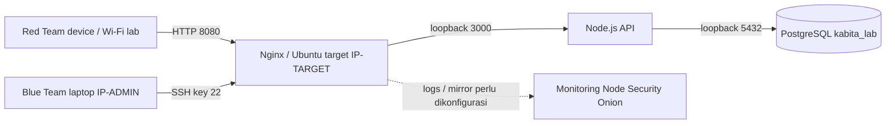

# IP plan - kondisi 23 Oktober 2026 WIB

| Node | Alamat | Peran |
|---|---|---|
| Laptop pengelola Windows | IP-ADMIN/24 | SSH dan browser Blue Team |
| Target Ubuntu 24.04.1 | IP-TARGET/24 (DHCP) | Nginx :8080, aplikasi dan PostgreSQL |
| Adapter NAT target | 10.0.3.15/24 | koneksi keluar; gateway 10.0.3.2 |
| Host localhost | 127.0.0.1:2222 | VirtualBox NAT forwarding ke SSH target :22 |
| Red Team device lain | DHCP di subnet lab, catat saat sesi | Nmap/curl/Burp |
| Monitoring Node | Belum ditetapkan | Security Onion + log ingestion/mirror |

Adapter 1 Bridged ke MediaTek Wi-Fi; adapter 2 NAT. Web diakses langsung melalui IP VM, tidak melalui port-forward Windows. IP berubah mengikuti DHCP; lakukan reservasi DHCP bila diperlukan. Jika memakai hotspot dengan client isolation, perangkat lain mungkin tidak bisa menjangkau VM meskipun SSID sama.

